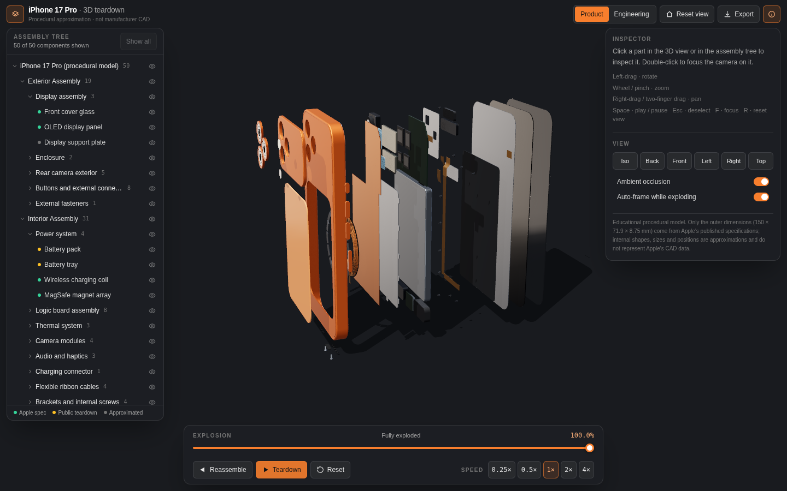
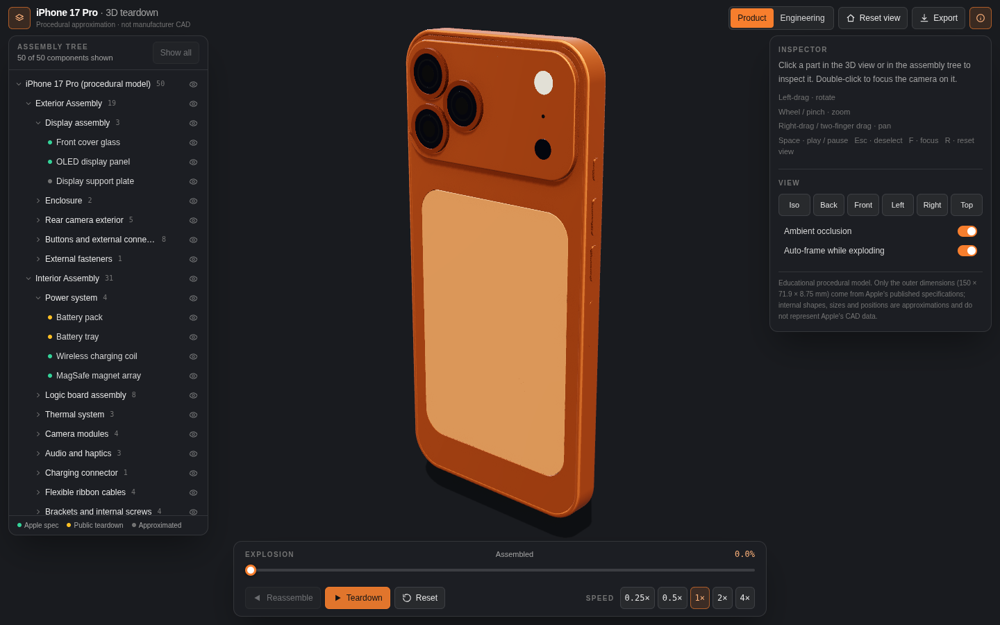
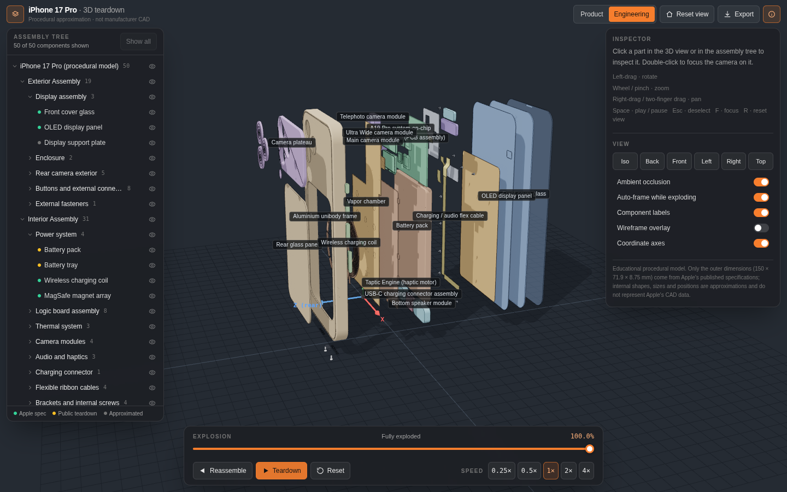
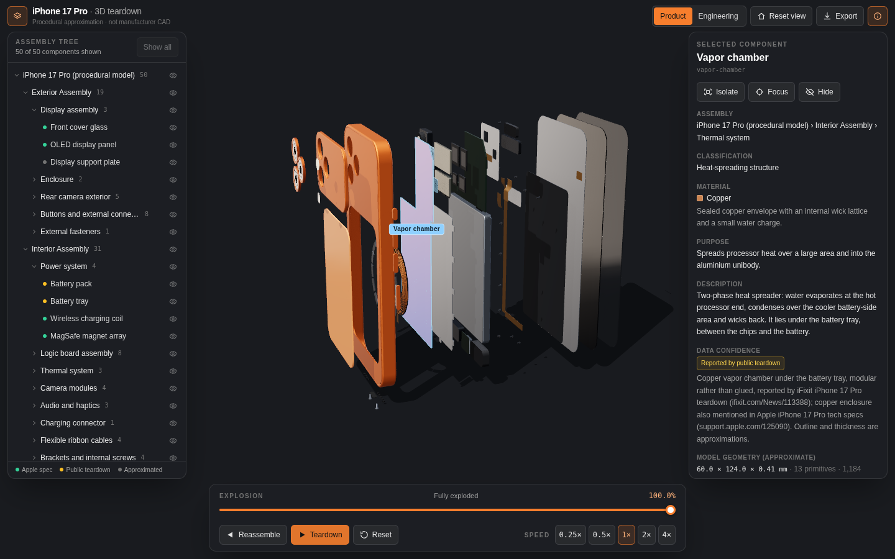

# iPhone 17 Pro – interactive 3D teardown and exploded-view simulator

A browser-based teardown simulator of an iPhone 17 Pro-style smartphone. Rotate the phone, drag a slider to pull it apart into 50 components, click any part to inspect it, isolate it, and put everything back together.

All geometry is **generated in code** from parametric primitives (223 primitives, about 98,000 triangles). The app downloads no CAD files, GLB models, textures, fonts or HDRIs.

> **This is an educational approximation, not Apple's design.** Only the outer dimensions and the parts list items named in Apple's public tech specs are sourced. Every internal shape, size and position is an estimate made to give a coherent assembly. Nothing here is derived from, or should be presented as, Apple CAD data. See [What is verified and what is approximated](#what-is-verified-and-what-is-approximated).



| Assembled | Engineering mode | Component selected |
|---|---|---|
|  |  |  |

## Run it

Requires Node.js 18 or newer (developed on Node 20.19) and a browser with WebGL 2.

```bash
cd iphone17pro_teardown
npm install
npm run dev          # then open http://127.0.0.1:5173
```

Other commands:

| Command | What it does |
|---|---|
| `npm run build` | Type-check and build a static bundle into `dist/` |
| `npm run preview` | Serve the built bundle on http://127.0.0.1:4173 |
| `npm test` | Unit tests for assembly transforms, hierarchy, geometry and selection (Vitest, no browser needed) |
| `npm run e2e` | Functional test in headless Chrome, plus regenerate the screenshots |
| `npm run screenshots` | Regenerate `docs/screenshots/*.png` only |
| `npm run docs` | Regenerate [docs/COMPONENTS.md](docs/COMPONENTS.md) from the component data |
| `npm run verify` | Type-check, unit tests and e2e in one go |

`npm run e2e` and `npm run screenshots` need a local Chrome or Chromium. They look in the usual install locations; set `CHROME_PATH=/path/to/chrome` if yours is elsewhere. They start their own dev server on port 5199.

## Using the simulator

**Camera**

| Action | Mouse | Touch |
|---|---|---|
| Rotate | Left-drag | One-finger drag |
| Zoom | Wheel | Pinch |
| Pan | Right-drag | Two-finger drag |
| Focus on a part | Double-click it | Double-tap it |
| Reset | **Reset view** button, or `R` | **Reset view** button |

The **View** section of the inspector has Iso / Back / Front / Left / Right / Top presets. With **Auto-frame while exploding** on (the default), the camera pulls back and swings side-on as the phone opens, then returns as it closes. It only applies relative changes, so your own zoom and orbit are kept. Turn it off for a fixed camera.

**Disassembly** (bottom bar)

- **Slider** – explosion progress from 0 % (assembled) to 100 % (fully exploded), continuous.
- **Teardown** – play or pause the automated teardown (`Space`).
- **Reassemble** – play in reverse from the current state.
- **Reset** – close the phone quickly and show every component again.
- **Speed** – 0.25× to 4×.

**Inspection**

- Click a part in the 3D view or in the assembly tree to select it. It gets a blue tint, an outline and a label, and the inspector shows its name, assembly path, classification, material, purpose, description and data confidence.
- **Isolate** shows only that part (`I`); **Restore assembly** or **Show all** brings everything back. `Esc` leaves isolation, then deselects.
- In the assembly tree, the eye icon hides or shows a part or a whole sub-assembly, and the frame icon on a sub-assembly row isolates that group.
- The coloured dot beside each part shows its data basis: green = Apple spec, amber = public teardown, grey = approximated.

**Rendering modes** (top bar)

- **Product** – physically based materials, procedural studio lighting, soft shadows and ambient occlusion.
- **Engineering** – neutral matte colours per sub-assembly, visible component boundaries, floating labels, a floor grid and an X/Y/Z triad. Toggles for labels, wireframe overlay and axes appear in the inspector.

**Export** (top bar) – screenshot (PNG), the visible parts at the current explosion state (GLB), or an assembly manifest (JSON: hierarchy, metadata and assembled / exploded / current transforms).

## What is verified and what is approximated

Sources, both read on 2026-11-16:

- **Apple** – iPhone 17 Pro tech specs, <https://support.apple.com/en-ie/125090>
- **iFixit** – iPhone 17 Pro teardown article, <https://www.ifixit.com/News/113388/iphone-17-pro-teardown>

Each component carries one of three flags, shown in the UI and listed per part in [docs/COMPONENTS.md](docs/COMPONENTS.md). The flag describes what supports the part's **existence and construction**. It never means the modelled shape is accurate.

| Flag | Count | Meaning |
|---|---|---|
| Apple spec | 18 | The part or feature is named in Apple's tech specs |
| Public teardown | 10 | Its construction is described in the iFixit article |
| Approximated | 22 | A plausible engineering guess with no public confirmation |

**Taken from Apple's tech specs**

- Outer dimensions 150 × 71.9 × 8.75 mm (the frame model matches these; a unit test checks it). Weight 204 g is recorded but not modelled.
- Aluminium unibody; Ceramic Shield 2 front; Ceramic Shield back; Cosmic Orange finish.
- 6.3-inch OLED display; A19 Pro chip.
- Three 48 MP rear cameras (Main 24 mm ƒ/1.78, Ultra Wide 13 mm ƒ/2.2, Telephoto 100 mm ƒ/2.8) and an 18 MP front camera.
- Action button, Camera Control, side button, volume buttons, USB-C connector, nano-SIM + eSIM.
- MagSafe / Qi2 wireless charging with a magnet array and alignment magnet; a vapour chamber with a copper enclosure.

**Taken from the iFixit teardown article**

- The battery sits in a metal shell on a removable tray held by fourteen Torx Plus screws, bonded with electrically debonding adhesive.
- The vapor chamber lies under the battery tray, between the chips and the battery, and is not glued to the chassis.
- The logic board sits above the battery and edges into the camera plateau.
- The rear glass is a small inset that only gives access to the wireless-charging coil; most repairs go in through the display.
- The camera plateau is anodised aluminium and part of the rear case.
- Pentalobe screws at the bottom; Torx Plus around the battery and rear cameras; five screw drive types overall.

**Approximated (everything else)**, including:

- All internal dimensions, thicknesses, outlines and positions, for sourced parts too (battery 60 × 82 × 4.6 mm, wall 2.0 mm, rear shell 0.8 mm, plateau height 2.2 mm, corner radius 11.5 mm, and so on).
- Which rear camera sits in which of the three lens positions.
- The logic board outline, which side its chips face, and every chip other than the A19 Pro (storage, power management, modem, RF modules), their shields and thermal pads.
- The display support plate, graphite sheet, speaker, earpiece, Taptic Engine, brackets and all flex-cable routing.
- Screw positions. The model shows 24 representative screws; the real phone has many more.
- Material colours and PBR values, chosen by eye.

## Architecture

Geometry definitions are plain data and know nothing about rendering or the UI. Rendering reads the data through small, framework-free core modules.

```
src/
  core/                     framework-free logic (no React)
    types.ts                ComponentMetadata, ComponentDefinition, GeomSpec, GeometrySource …
    ComponentRegistry.ts    register / replace / look up component definitions
    AssemblyTree.ts         hierarchy, paths, descendants, validation
    GeometryFactory.ts      GeomSpec → BufferGeometry (cached), edges, bounding boxes
    MaterialFactory.ts      MaterialDefinition → three.js material per rendering mode
    ExplosionController.ts  explosionProgress → pose (pure function, per-component staging)
    SelectionManager.ts     select / hide / isolate / restore state transitions
    CameraController.ts     reset, view presets, focus, auto-framing
    SceneExporter.ts        GLB, JSON manifest, PNG
    CollisionProxy.ts       occupancy-cell interpenetration check used by the tests
    AssetLoader.ts          GLB / STL / OBJ loading for future CAD-derived parts
  data/                     the phone itself, as data
    dimensions.ts           envelope, layer offsets, staging rule, screw helper
    materials.ts            material library and engineering-mode colours
    exterior.ts interior.ts component definitions (metadata + primitives + transforms)
    assembly.ts             sub-assembly nodes
  state/                    zustand store, GSAP playback
  scene/                    React Three Fiber viewer and component renderer
  ui/                       Tailwind panels: tree, inspector, explosion controls
tests/                      Vitest unit tests
scripts/e2e.mjs             headless-Chrome functional test and screenshots
```

**Coordinates and units.** Millimetres. +X is to the right when looking at the back of the phone, +Y is the top, +Z points out of the back.

**Explosion.** Every component has an assembled and an exploded transform plus a stage window. `ExplosionController` maps `explosionProgress ∈ [0, 1]` to a pose with smoothstep easing and quaternion slerp. The pose is a pure function of the progress value and nothing accumulates between frames, so scrubbing, reversing and replaying cannot drift: progress 0 returns the assembled transform exactly. Parts move along group-specific directions: the display stack towards −Z, the enclosure and camera covers towards +Z, internals to intermediate layers in stacking order, buttons and the SIM tray sideways, bottom-edge features downwards. Outer layers start first and inner layers follow, which keeps stacked parts in order throughout.

**Replacing a procedural part with CAD geometry.** A component's `geometry` field is either `{ type: 'procedural', parts: [...] }` or `{ type: 'asset', format: 'glb' | 'stl' | 'obj', url, scale?, rotation?, offset? }`. To swap one in:

```ts
import { registry } from './data';
registry.replace({
  ...registry.get('battery'),
  geometry: { type: 'asset', format: 'glb', url: '/models/battery.glb', scale: 1 },
});
```

Put the file under `public/models/`. Metadata, transforms, explosion, selection and the tree keep working unchanged. Browsers cannot read STEP directly, so tessellate STEP to GLB, STL or OBJ first (FreeCAD, CAD Assistant, Abaqus/CAE export, or `occt-import-js`). The STL and OBJ parsers are unit-tested with in-memory files; the asset path has **not** been exercised with a real CAD-derived model in the running app.

## Tests

`npm test` runs 33 unit tests in Node (no WebGL needed):

- **Registry and hierarchy** – unique IDs, complete metadata, every component attached to Exterior or Interior under one root, no empty sub-assemblies, sourced parts cite their source.
- **Geometry** – every primitive builds with finite vertices; the frame matches 150 × 71.9 × 8.75 mm; every assembled part stays inside the device envelope and every interior part inside the cavity; camera modules line up with their lens covers.
- **Explosion transforms** – progress 0 and 1 give exactly the assembled and exploded transforms; out-of-range values clamp; motion is continuous, monotonic and straight-line; orientation slerp stays unit-length.
- **Reassembly** – after 4,000 forward, backward and random scrubs, every component returns to its original position and rotation bit-for-bit.
- **Interpenetration** – part surfaces are binned into 3 mm occupancy cells and the explosion is sampled at 40 steps; no pair of parts may overlap during the motion unless those same cells already touched when assembled. One exception is allow-listed and documented below (SIM tray through the frame wall).
- **Selection** – isolate, hide, show and restore, including whole sub-assemblies.

`npm run e2e` drives the real UI in headless Chrome and checks startup framing, the slider, play / pause / reverse / reset, bit-exact reassembly in the live scene, mouse and touch camera controls, click selection, double-click focus, isolation, hide / show, engineering mode, export, a portrait phone viewport, and that there are no console errors and no requests to anything but the local dev server.

**Results on 2026-11-16** (Node 20.19, Chrome headless with SwiftShader software rendering, Linux): `npm test` 33 of 33 passed; `npm run e2e` 33 of 33 checks passed, with no console errors and no external requests. The only console warnings come from three.js's GLB exporter normalising normals during the export check. The production build (`npm run build`) also completes.

## Known limitations

- **Not an accurate model.** See the section above. Use it to understand how a phone like this goes together, not to take measurements.
- **No holes in the frame's side walls.** Button holes, the SIM slot, the USB-C opening, speaker ports and antenna breaks are not cut. Openings are shown as dark inlays. As a result the SIM tray visibly slides out through the solid wall, which is the one interpenetration the collision test allow-lists.
- **The camera plateau is a separate piece** so the exploded view can show what is under it. On the real phone it is part of the unibody.
- **The interpenetration check is approximate**: 3 mm cells, 40 sampled steps, surfaces only. It catches parts being driven through each other but is not an exact solid-collision test. Parts that already touch or nest when assembled (screws in their bosses, lens barrels in their holes) are excluded by construction.
- **Small details are omitted**: passive components, connectors, adhesives, gaskets, antennas, microphones, most screws, the logo.
- **Exploded view is a single linear motion per part.** There are no multi-step removal paths (for example "slide out, then lift").
- **GLB export** contains the visible meshes with basic PBR materials at the current pose. Labels and outlines are left out.
- **STEP import is not built in**; see the conversion note above.
- **Performance** was only measured here with software rendering on a heavily loaded shared machine (roughly 1 frame per second in headless Chrome), which says little about real use. The scene is light (about 98k triangles, 223 draw calls plus a shadow pass), so any GPU from the last several years should run it smoothly, but that has not been measured. If it is slow, turn off **Ambient occlusion** in the inspector.
- No reference screenshot was available when this was built, so the look follows the written brief rather than a specific image.
